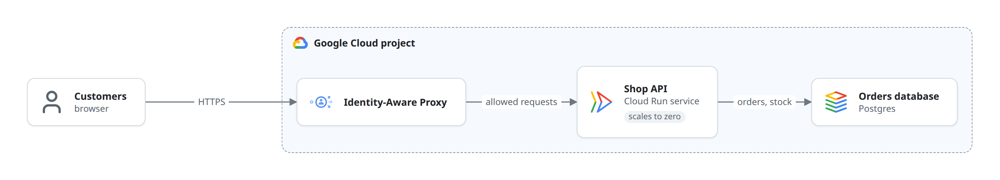

# in-ctrl

Code and docs you stay in control of.



AI can write a lot of code quickly. Staying in control means knowing what the code does: how the parts fit, what flows through them, where it runs. in-ctrl keeps that knowledge in your repository, as plain Markdown and small YAML diagrams that you review and change with the code, and makes it pleasant to read:

- **Review:** a stack of branches, one page each: what the branch is for, its diff (split or unified, file by file or as a walkthrough), the docs and diagrams it changes before and after, comments on any line, files marked reviewed, and a verdict. Approving merges. An agent reads the review and answers from a shell.
- **Diagrams from YAML:** architecture, deployment, flowcharts, lifecycles, tables (laid out by ELK, drawn with React Flow) and sequence diagrams, with real product icons (Google Cloud, Cloudflare, Docker, …), in light and dark.
- **Readable everywhere:** each diagram is also rendered to a PNG next to its source, which the Markdown embeds, so the docs read on GitHub and in any editor.
- **A docs site:** your `docs/` folder as a site with navigation, search and dark mode (Astro Starlight). Inline diagrams stay still while you scroll or swipe the page; hover follows a line and clicking a box opens its page. Press **Full screen** to pan/zoom a graph or scroll a large sequence; use **Exit full screen** or Escape to return to the same place in the page. Large graphs open at a readable scale; use **Fit view** for an overview. Each diagram has an accessible **Diagram help** info button with graph/sequence-specific controls, so pages do not need to repeat interaction instructions.
- **Checks:** `in-ctrl check` fails when a PNG is older than its YAML, a diagram isn't shown anywhere, or an icon doesn't exist, without a browser, so it runs anywhere CI does.

## Use it

```bash
npm install --save-dev in-ctrl      # or: pnpm add -D in-ctrl
npx playwright install chromium     # once, for rendering PNGs

npx in-ctrl render                  # draw the diagrams that changed into their PNGs
npx in-ctrl check                   # are the PNGs current?
npx in-ctrl dev                     # every diagram, light and dark, in the browser
npx in-ctrl site dev                # the docs site, live (with comments)
npx in-ctrl site build dist-docs    # the docs site, for hosting
npx in-ctrl site serve dist-docs --host 0.0.0.0 --port 8080   # serve a built site (with comments)
npx in-ctrl comments                # open comment threads, as Markdown
npx in-ctrl comments reply ID TEXT  # answer a thread from a shell
```

Settings live in `in-ctrl.config.yaml` at the project root:

```yaml
title: Shop
description: How the shop works.
docs: docs                       # the Markdown folder
home: README.md                  # the site's front page
repo: https://github.com/you/shop
site:
  url: https://you.github.io
  base: /shop/
  sidebar: [guide, design, { dir: dev, label: Developer docs }]
vocabulary:                      # names every diagram draws the same way
  API: { label: Shop API, icon: "gcp:cloud-run" }
  DB: { label: Orders database, icon: "gcp:cloud-sql" }
comments: .in-ctrl/comments.json # where the site keeps comments (false to turn off)
```

The site takes your Markdown as it is: the first `# Heading` is the page title, `README.md` is a folder's page, links between docs become site links, and links to code go to GitHub.

### Sidebar

`sidebar` lists the top-level docs folders in order (the rest follow A to Z). A folder listed by name or as `{ dir, label }` is listed A to Z inside. Give it `items` or `order` to name and order what's inside it too:

```yaml
site:
  sidebar:
    - guide
    - dir: handbook
      label: Handbook
      items:                       # sub-folders in this order; the rest follow A to Z
        - { dir: guides, label: Guides }
        - reference                # labelled "Reference"
        - { dir: articles, label: Reports, order: newest-first, collapsed: true }
```

`order` is `az` (the default) or `newest-first`, for reports: numbered pages highest number first, then the rest Z to A by file name. A folder's own page always comes first, then pinned pages.

A page can start with front matter for the sidebar; the page keeps its full title:

```markdown
---
number: 27                 # "27 · …" in the sidebar; orders a newest-first folder
sidebar_label: Beta       # short sidebar label (default: the title)
pinned: true               # first in its folder, after the folder's own page
---
# 2026-10-05 — Beta opens to everyone, and what changed
```

Numbers are the author's to keep: a new page takes the next one, and old ones never change, so links and references to "report 27" stay true.

### Page metadata

Declare provenance in front matter; the site renders it as a small line beneath the title:

```yaml
metadata:
  Updated at: "2026-10-07T12:00:00+09:00"
  Git SHA at edit: "fe1630d + working changes"
```

Labels and values are author-owned text. Reports can use `Runtime` instead of a documentation revision. The site also recognizes an existing leading `> Updated at: …` line, preserving its text and comment position without editing the source. Pages without declared metadata get no invented date or revision; build time never replaces recorded provenance.

### Reading width

The header has buttons that hide the sidebar and the table of contents (`[` and `]` from the keyboard); the page keeps the reader's choice. The content column starts next to the sidebar and widens to the whole page when both are hidden.

### Moved pages and the 404 page

When pages move, list their old paths under `site.redirects` so old links keep working. A key ending in `*` moves a whole folder, page by page:

```yaml
site:
  redirects:
    /guide/setup/: /guides/setup/
    /using/*: /guides/using/*
```

`site build` writes a small redirect page at each old path (any static host follows it), never over a page that exists. `site serve` answers old paths with a 302, serves folders' `index.html`, and gives anything missing the site's own 404 page with status 404, using only Node.

## Review a stack of branches

`in-ctrl review` is a site for reviewing a stack of branches (`stack/01-…`, `stack/02-…`, each built on the one before), one page per branch. It lives in a folder of its own, next to the code or in it:

```
review/
  in-ctrl.config.yaml      # title, and the review section below
  index.html               # the front page
  pages/review/01-discounts.html   # a page per branch (any folders under pages/)
  maps.yaml                # optional: the parts of the project, for the impact map
  public/                  # optional: images and files the pages use
```

```yaml
title: Shop review
review:
  repo: ../shop            # the git repository (default: the one this folder is in)
  branchPrefix: stack/     # the stack: these branches, in name order
  baseBranch: main         # approving merges into it
  stackBase: 1a2b3c4       # what the first branch is diffed against (default: baseBranch)
  publicRemote: origin     # optional: merging also pushes the base branch there
```

```bash
npx in-ctrl review gen               # the branches' diffs and the pages' index, from git (generated/)
npx in-ctrl review dev               # the review, live, on 127.0.0.1:5192
npx in-ctrl review publish           # build a release and make it the live one
npx in-ctrl review serve 127.0.0.1:5190   # serve the live release, the comments and the inbox
npx in-ctrl review merge [--apply]   # fast-forward the base branch over the approved branches
npx in-ctrl review inbox wait        # wait for the reader to send the review to the agent
```

A page is plain HTML. Metas place it and the elements in it draw from the branch:

```html
<title>01 · Discounts on the cart's total</title>
<meta name="guide:section" content="review">
<meta name="guide:parent" content="/pages/review/index.html">
<meta name="guide:branch" content="stack/01-discounts">
<meta name="guide:kind" content="feature">        <!-- security, fix, feature, cleanup, deps, docs, … -->
<meta name="guide:oneliner" content="**Discounts** come off the cart's total.">

<guide-nav></guide-nav>
<main>
<review-header branch="stack/01-discounts" risk="low"></review-header>
<review-summary><script type="application/yaml">
why: Customers had no way to use a coupon.
what: "`total(items, discount)` takes the discount off the sum."
</script></review-summary>
<h2 id="code">Code</h2>
<review-code branch="stack/01-discounts"></review-code>
</main>
```

- `<review-header>`: the branch, its verdict, files and lines changed, review progress, and the branches before and after it.
- `<review-code>`: the diff. With `<walk-file file="…">` children it is a walkthrough in that order, with your headings between files; otherwise the files.
- `<review-summary>`: why, what, impact and risk, next to a map of the parts the branch changes (`maps.yaml`).
- `<review-notes branch="…">`: notes pinned to diff lines (`file`, `at: text on the line`, `kind`, `text` in YAML).
- `<branch-flows>`: the docs diagrams (`*.diagram.yaml`) the branch changes, as a diff, before and after. `<doc-previews auto>`: the docs pages it changes, as built pages, before and after.
- `<review-list>`: every branch in the stack, at a glance. `<repo-markdown file="…">`: a Markdown file from the repository. `<docs-diagram file="…">`: a diagram from the repository.

The sidebar lists every page, grouped by `guide:section` and nested by `guide:parent`, with each branch's lines added and removed and how its review is going.

The review is kept with the comments (`comments`, default `.in-ctrl/comments.json`): comments on lines and on page text, files marked reviewed, verdicts. Every device that opens the review shares it. `in-ctrl comments` prints the open threads and verdicts for an agent, which answers with `in-ctrl comments reply ID TEXT`. Readers press 🤖 to send the review to the agent with a note; the agent picks it up with `in-ctrl review inbox wait`, marks it `start ID`, and `done ID SUMMARY`, and the reader sees each step.

Approve means merge: `in-ctrl review merge --apply` fast-forwards the base branch (in the worktree that has it checked out, if it's clean) to the last branch of the unbroken run of approved branches after it. A later approval waits for the branches before it.

More settings: `pages` (default `pages`), `inbox` (default `.in-ctrl/inbox.json`), `branches` (branches outside the stack, each `{ name, base }`), `stackParents` (a branch's parent, when it isn't the one before), `mergedRefs` (history that counts as merged besides the base branch), `docsRef` (where the repository's docs are read from), `docPreviews` (branch → the ref its docs are compared with), `annotationKinds` (the kinds of notes; default `important` and `detail`), `editorLink` (open a file in your editor, e.g. `vscode://file/{abs}:{line}`), `client` (a module of your own elements), `alias` (import name → path, e.g. one React for your elements and in-ctrl's).

## Publish the site on GitHub Pages

In the repository's settings, set Pages to deploy from GitHub Actions, then add:

```yaml
# .github/workflows/docs.yml
name: Docs
on:
  push:
    branches: [main]
    paths: ["docs/**", "README.md", "in-ctrl.config.yaml"]
  workflow_dispatch:
jobs:
  docs:
    uses: gajop/in-ctrl/.github/workflows/pages.yml@v0.1.0
    permissions:
      contents: read
      pages: write
      id-token: write
```

It uses only GitHub's own token: no secrets, nothing deployed anywhere else.

## Graphs

```yaml
title: The shop on one machine
direction: RIGHT                 # or DOWN
nodes:
  - { id: machine, label: Your machine, icon: "lucide:laptop", kind: boundary }
  - { id: api, in: machine, is: API, detail: "serves the web shop" }
  - { id: db, in: machine, label: SQLite, icon: "devicon:sqlite", tags: [one file] }
  - { id: ready, shape: decision, label: "Every dependency\nended?" }
  - { id: ok, shape: state, label: success, tone: good }
edges:
  - { from: api, to: db, label: "reads, writes" }   # style: dashed, both: true
```

Node fields:

- `id`, and `label` (`\n` breaks the line). `detail` is a smaller second line.
- `is`: a name from the project's vocabulary (`vocabulary:` in `in-ctrl.config.yaml`). It gives the label and icon, so the same thing looks the same in every diagram. `label` and `icon` override it.
- `icon`: `gcp:*` and `cloudflare:*` from [icons/](icons/), or any icon of the `logos`, `devicon` and `lucide` sets on [Iconify](https://icon-sets.iconify.design/).
- `in`: the box this node sits in. A node with `kind: boundary` (an account, project or machine; dashed) or `kind: process` (one running program; solid), or one that others are `in`, is a box around them.
- `shape`:
  - `box`, the default: icon, label, detail and tags
  - `decision`: a diamond, for a question with labelled answers on its edges
  - `state`: a status, as a pill; with `tone: good | bad | quiet | accent` for results
  - `start`, `end`: the dots of a lifecycle
  - `entity`: a table, with `fields: ["name text UK", …]`
  - `note`: a dashed box of text
- `tags`: short facts as pills ("1 instance", "scales to zero").
- `link`: a relative doc link the guide follows when the node is clicked.

Edges: `from`, `to`, `label`, `style: dashed` (polling, background or optional), `both: true` (arrowheads at both ends), `main: true` (the main path: kept straight; a decision's main answer leaves from its front tip and the others from its side). Long labels wrap by themselves.

Layout tips:

- Nodes and edges are laid out in the order they are written. Write the main path first; a later edge that goes back (a retry, a resume) is drawn pointing back.
- In a chain of questions, mark the main path `main: true` and give each question its own outcome box (two `failed` boxes are fine), so every answer is a short arrow to the side.
- Lifecycles and wide flows read best left to right; architecture and deployment maps often fit the page better top-down (`direction: DOWN`).
- Don't nest boxes in lifecycles: an edge into or out of a box gets kinks. Say "from any unfinished state" in a label instead.
- Keep a diagram to about 12 nodes. Split bigger ones into an overview whose boxes `link` to one diagram per part.

## Sequences

```yaml
type: sequence
title: Placing an order
participants:
  - { id: api, is: API }
  - { id: db, is: DB }
  - { id: pay, label: Payments, icon: "lucide:credit-card" }
steps:
  - { from: api, to: db, label: is it in stock? }
  - { from: db, to: api, label: "yes, 3 left", kind: return }
  - loop: until the payment settles
    steps:
      - { from: api, to: pay, label: charge the card }
      - { from: pay, to: api, label: pending, kind: async }
  - alt:
      - when: paid
        steps:
          - { from: api, to: db, label: store the order }
      - when: declined
        steps:
          - { from: api, to: db, label: release the stock }
  - { note: "The customer sees the result.", over: [api, db] }
```

- Participants take `is`, `label` and `icon` like graph nodes.
- Message `kind`: `call` (solid, the default), `return` (dashed), `async` (open arrowhead: a report over a channel). `from` equal to `to` is a step a participant takes on its own.
- Frames: `alt` and `par` take a list of `{ when, steps }`; `opt` and `loop` take a label and `steps`. `phase: Name` with `steps` is a tinted band across the diagram, for the phases of a long flow.
- `note` with `over: one id` or `over: [first, last]`.
- Keep a sequence to about 12 messages and one level of frames inside frames.

### Comments

Fullscreen diagrams keep a **Comment** button inside the reading view. Pick an element in **About**, or hover/tap a diagram element and use its comment button. Threads and drafts move into the review panel and return to their original page position when it closes. Escape in the panel closes comments first and keeps the draft; a subsequent Escape exits fullscreen. The same comment anchors and API work in either view.

Readers comment on any paragraph, list item, table row, heading or diagram box: point at it (or tap it on a phone) and press 💬. Threads show under their block, with reply, edit, resolve and delete, and a 💬 button lists every thread on the site.

Comments live in one JSON file in the project (`comments`, default `.in-ctrl/comments.json`; a folder in-ctrl makes for it gets a `.gitignore`). `site dev` and `site serve` both answer the comments API (`{base}_in-ctrl/comments`), so a built site served with `site serve --root PROJECT` takes comments from every device that can reach it; `--comments FILE` picks another file, `--no-comments` turns it off. Built pages ask for the API and show no comment UI where there is none, so the same build works on any static host.

Agents read the open threads with `in-ctrl comments` (`--all` adds resolved ones) and answer with `in-ctrl comments reply ID TEXT [--as NAME]`; open pages show the reply without a reload.
