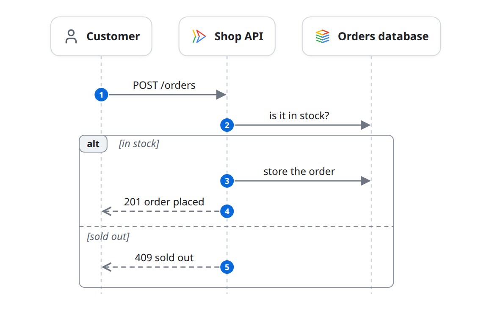

# How the shop runs

The shop is one API on Cloud Run, in front of a Postgres database on Cloud SQL. People reach it through Identity-Aware Proxy.

## Placing an order

A customer's order is checked, stored, and confirmed in one request.

